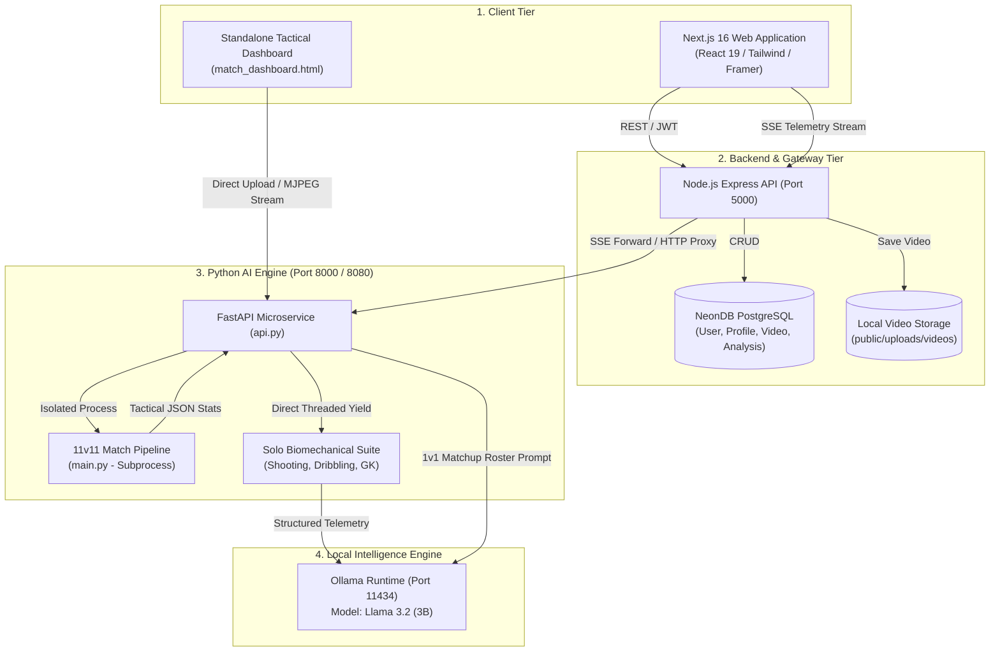
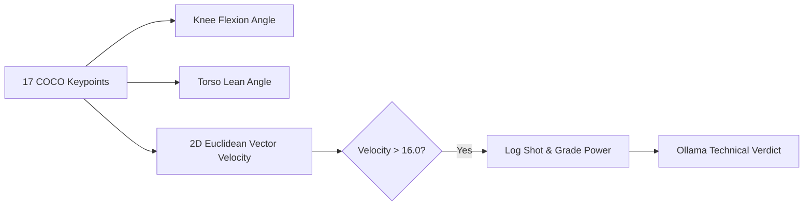
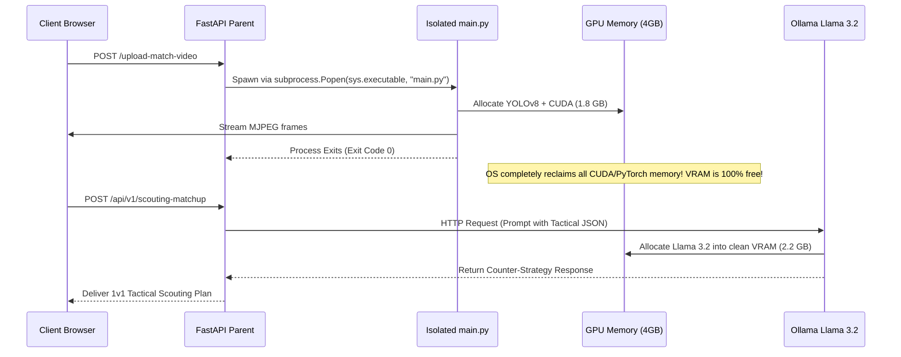
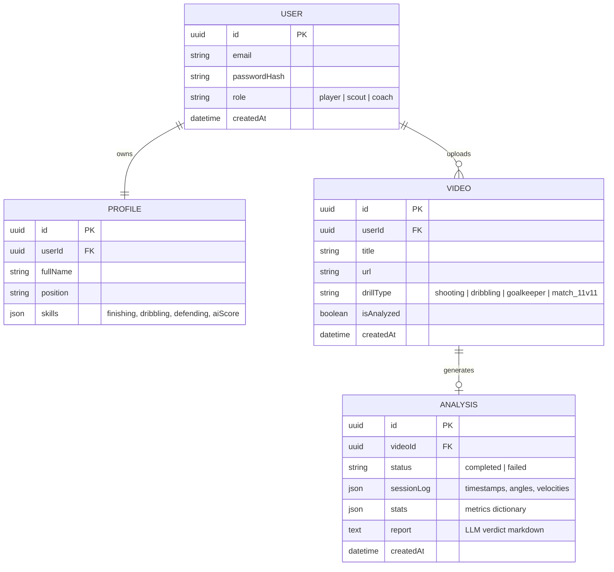

# 🏗️ Mission 2038 — Technical Architecture Blueprint

This document details the architectural design, algorithmic pipelines, hardware constraints, and data flows powering the **Mission 2038** football intelligence platform.

---

## 1. High-Level System Architecture

Mission 2038 operates as a decoupled 3-tier microservice architecture with local LLM integration:



---

## 2. Decoupled Service Interaction & Protocols

| Channel | Protocol | Payload Type | Description |
| :--- | :--- | :--- | :--- |
| **Frontend $\rightarrow$ Express** | HTTPS / REST | JSON / Multipart Form | Authentication, video uploads, session history, profile metrics. |
| **Express $\rightarrow$ FastAPI** | HTTP Proxy | Video URL / Form | Video dispatching to Python AI microservice. |
| **FastAPI $\rightarrow$ Express $\rightarrow$ UI** | **Server-Sent Events (SSE)** | `text/event-stream` (JSON) | Live frame-by-frame joint telemetry, logs, and coaching reports for solo drills. |
| **FastAPI $\rightarrow$ Test UI** | **Multipart MJPEG** | `multipart/x-mixed-replace` | Live continuous JPEG frame streaming of 11v11 tactical pitch annotations. |
| **FastAPI $\rightarrow$ Ollama** | HTTP POST | JSON (`/api/generate`) | Zero-latency local LLM prompting with a 120s cold-start timeout threshold. |

---

## 3. 11v11 Match Tactical Tracking Pipeline (`main.py`)

The 11v11 tactical analysis pipeline transforms uncalibrated broadcast match video into tactical pitch intelligence.

```mermaid
flowchart TD
    Vid[Raw Video Input] --> Read[Frame Extraction (utils.read_video)]
    Read --> Det[YOLOv8 Object Detection (Person, Ball)]
    Det --> Tracker[ByteTrack Multi-Object Tracking]
    Tracker --> Interp[Ball Position Interpolation]
    Tracker --> Camera[Camera Movement Estimator (Optical Flow)]
    Tracker --> Trans[ViewTransformer (Homography)]
    Tracker --> Team[TeamAssigner (K-Means Kit Clustering)]
    Tracker --> BallAssign[PlayerBallAssigner (Possession)]
    Trans --> Speed[SpeedAndDistance_Estimator]
    Speed --> Top22Filter[Top-22 Athletic Filtering]
    Top22Filter --> Export[tactical_stats.json Export]
    Speed --> Annotate[Annotation Drawing Engine]
    Annotate --> StreamOrSave{Stream Flag Active?}
    StreamOrSave -- Yes --> MJPEG[MJPEG Binary Output to stdout]
    StreamOrSave -- No --> SaveVid[Save to output_videos/output_video.avi]
```

### Mathematical & Algorithmic Modules:
1. **Multi-Object Tracking (`trackers/tracker.py`):**
   - Uses `supervision.ByteTrack()` to maintain temporal track IDs across occlusion.
   - Interpolates missing ball detections using cubic spline/linear interpolation across tracklet gaps.
2. **Team Kit Classification (`team_assigner/team_assigner.py`):**
   - Crops the upper 50% of detected player bounding boxes (isolating jerseys from shorts and grass).
   - Runs K-Means ($k=2$) on RGB color space to separate jersey pigment from the pitch, then clusters players across the match into Team 1 and Team 2.
3. **Scale-Invariant Camera Motion (`camera_movement_estimator.py`):**
   - Computes Lucas-Kanade optical flow across frame corners.
   - Extracts camera pan/zoom offsets to subtract stadium motion from player velocities.
4. **View Perspective Homography (`view_transformer.py`):**
   - Projects 2D pixel coordinates $(u, v)$ onto standardized pitch meters $(X, Y)$ via perspective transformation matrix $H$:
     $$\begin{bmatrix} X \\ Y \\ 1 \end{bmatrix} \sim H \begin{bmatrix} u \\ v \\ 1 \end{bmatrix}$$
5. **Speed & Distance Estimation (`speed_and_distance_estimator.py`):**
   - Derives Euclidean pitch distance over a sliding window ($w = 5\text{ frames}$):
     $$v = \frac{\Delta d}{\Delta t} \times 3.6\text{ km/h}$$
   - Filters out non-athletic spectator noise by taking the top 22 players by total distance covered.

---

## 4. Solo Player Biomechanical Coaching Suite (`coaching_modules/`)

The solo coaching suite provides automated, sports-science grade technique evaluation.

### A. 🎯 Striker / Shooting Coach (`ai_Coach.py`)

- **2D Vector Velocity ($\sqrt{\Delta x^2 + \Delta y^2}$):** Catches sweeping instep strikes, curling finishes, and volleys, resolving single-axis vertical tracking limitations.
- **Torso Lean Angle:** Measures the vector from Mid-Shoulder to Mid-Hip relative to vertical. Evaluates chest over ball (low driven shot) vs leaning backwards (skied shot warning).
- **Scale-Invariant Reference:** Normalizes limb velocities to the athlete's anatomical leg length ($L_{\text{leg}}$).

### B. ⚡ Dribbling Coach (`dribbling_coach.py`)
- **Scale-Invariant Control Radius:** Eliminates fixed-pixel threshold bugs across different camera zooms and resolutions:
  $$R_{\text{control}} = 0.42 \times L_{\text{leg}}$$
- **Adaptive ROI High-FPS Cropping:** Dynamically crops a window around the player's ankles ($1.5 \times L_{\text{leg}}$) to run targeted ball detection at high frame rates.
- **Debounced Touch Counter:** Requires a departure and re-entry state transition to prevent frame jitter from artificially inflating touch counts.

### C. 🧤 Goalkeeper Coach (`goalkeeper_coach.py`)
```mermaid
flowchart TD
    BallPath[Ball Trajectory History] --> ShotTrig[Velocity Spike Trigger]
    ShotTrig --> SetPos[Analyze Set-Position Readiness]
    ShotTrig --> Approach[Ball Reaches Keeper Bounding Box]
    Approach --> DeflectCheck{Trajectory Deflection Angle > 40° OR Speed Drop > 65%?}
    DeflectCheck -- Yes --> Save[CONFIRMED SAVE]
    DeflectCheck -- No --> Goal[GOAL CONCEDED (MISS)]
    Save --> DiveCalc[Calculate Maximum Dive Extension Ratio]
    Save --> RTCalc[Calculate Reaction Time]
```
- **Physics Trajectory Deflection:** Solves the 2D parallax "phantom save" flaw. Confirms a save only if the ball direction changes ($\Delta \theta > 40^\circ$), rebounds backwards, or rapidly decelerates into a catch. Balls passing through without deflection are graded as **Goals Conceded**.
- **Set Position Readiness Score ($0–100\%$):** Evaluates knee flexion spring angle ($105^\circ - 128^\circ$) and hand ready elevation in the 10 frames prior to shot release.
- **Maximum Dive Extension Ratio:** Measures lateral reach from lead wrist to push ankle relative to standing height.

---

## 5. Hardware Constraints & VRAM Safety Architecture

### The 4GB VRAM Safety Model
Running concurrent high-resolution YOLOv8 models alongside a 3B+ parameter local LLM on a consumer GPU with **4GB VRAM** will cause out-of-memory (OOM) crashes if unmanaged.



### Architectural Safeguards:
1. **Subprocess Process Boundaries:** The 11v11 match tracking pipeline is strictly executed in an isolated OS subprocess (`subprocess.Popen` / `subprocess.run`). When the script terminates, the operating system forcibly unmaps all CUDA contexts, releasing 100% of GPU memory.
2. **Cold-Start Timeout Buffering:** Local LLM requests to `http://localhost:11434/api/generate` feature an explicit **120.0-second timeout** to accommodate cold-start model weight loads from SSD into VRAM.
3. **No Stub Mode vs Caching:** During active match tracking, intermediate pickle stubs (`stubs/`) prevent duplicate inference runs on identical footage.

---

## 6. Real-Time Streaming Protocols

### 1. Server-Sent Events (SSE) for Solo Biomechanics
For player drill sessions, FastAPI uses asynchronous generators to stream frame data and telemetry events over a persistent connection:
```
data: {"type": "log", "data": "Tracking human athletic keypoints..."}
data: {"type": "frame", "image": "data:image/jpeg;base64,..."}
data: {"type": "result", "data": {"stats": {...}, "report": "..."}}
```

### 2. Live MJPEG Multipart Streaming for 11v11 Matches
When `--stream` is enabled on `main.py`, standard logs are routed to `sys.stderr`, while compressed JPEG bytes are blasted directly to `sys.__stdout__`:
```
--frame\r\n
Content-Type: image/jpeg\r\n\r\n
<binary JPEG data>\r\n
```
FastAPI captures these bytes via a chunked generator and yields a `StreamingResponse(media_type="multipart/x-mixed-replace; boundary=frame")`, allowing standard HTML `` tags to render live 11v11 pitch tactical telemetry.

---

## 7. Database & Entity Schema

The PostgreSQL database (managed via NeonDB) persists user accounts, profiles, videos, and analysis records:



---

## 8. Summary of Engineering Best Practices
- **Scale Invariance:** All athletic and ball proximity thresholds are dynamically normalized to human anatomical scale ($L_{\text{leg}}$ or $H_{\text{keeper}}$).
- **Physics-Gated Verification:** Kinetic deflection checks eliminate computer vision parallax illusions.
- **Hardware Efficiency:** Sequential subprocess isolation allows heavy CV and LLMs to run on 4GB VRAM consumer PCs.
- **Zero Hallucination Policy:** Fallback logic never fabricates fake saves or reaction times, guaranteeing trustworthy data for coaches and scouts.
